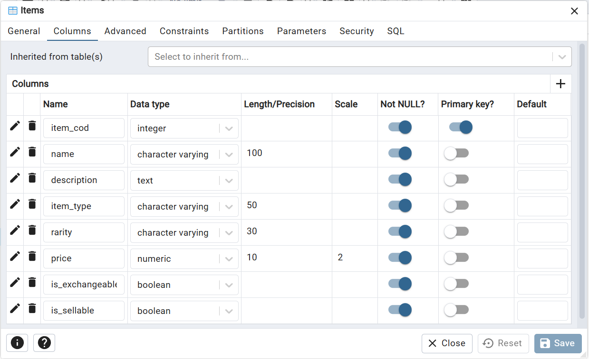
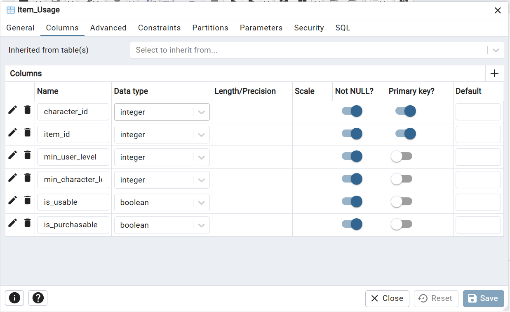
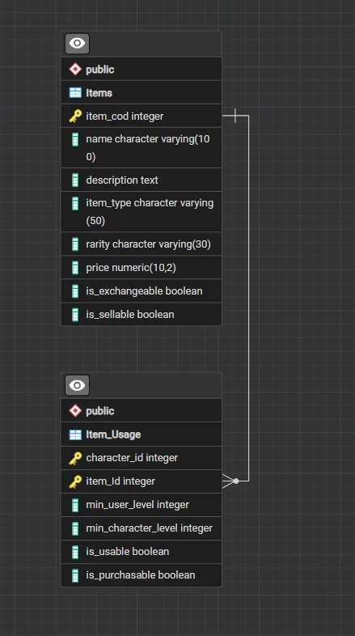

# Лабораторная работа №1. Вариант 39

**Тема:** Создание таблиц и обеспечение целостности данных в PostgreSQL.
**Вариант 39:** Предметы / Применение предметов.

## 📁 Состав репозитория

Все рабочие файлы находятся в папках `Tabel`.

| Файл | Описание |
|---|---|
| `Tabel/Items.sql` | SQL-скрипт создания таблицы `Items` (DDL) |
| `Tabel/Item_Usage.sql` | SQL-скрипт создания таблицы `Item_Usage` (DDL) |
| `Tabel/cod_zapol1.sql` | SQL-скрипт заполнения таблицы `Items` (DML) |
| `Tabel/cod_zapol2.sql` | SQL-скрипт заполнения таблицы `Item_Usage` (DML) |
| `Tabel/pipy.csv` | CSV-файл для импорта данных через мастер pgAdmin |

## 🗄 База данных и связи
База данных: `postgres`

На ERD-диаграмме отображена связь «один-ко-многим» (1:M):
* **`Items`** (главная таблица, первичный ключ `item_id`).
* **`Item_Usage`** (зависимая таблица, внешний ключ `item_id`).

Внешний ключ настроен с параметрами `ON UPDATE CASCADE` и `ON DELETE CASCADE`.

---

## 📸 Скриншоты выполнения работы

### 1. Создание таблиц в конструкторе
**Таблица Items:**

**Таблица Item_Usage:**

### 2. ERD-диаграмма базы данных

### 3. Проверка внешних ключей (Foreign Key)

